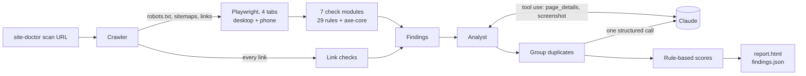

# 🩺 Site Doctor

**An AI agent that scans a whole website like a QA engineer, finds what's broken, and writes a scored report.**

[](https://github.com/panmm942-ui/site-doctor/actions/workflows/ci.yml)


Point it at a URL. A crawler loads every page it can find (sitemaps plus every link) in a real
Chromium browser, several at a time, and checks every link. On each page, 29 deterministic rules
plus the full axe-core accessibility suite look for broken links, JavaScript errors,
accessibility, SEO, Core Web Vitals, security headers and phone-layout problems. Then Claude
reviews the results like an analyst, inspects and screenshots the worst pages, and explains
every issue in plain English with a fix.


> The GIF, the report screenshot and [`examples/sample-report.html`](examples/sample-report.html)
> are generated by `site-doctor demo` (see [Recording the demo](#recording-the-demo)).

## How it works



Site Doctor splits the job between Claude and plain code:

- **Code crawls.** The crawler reads robots.txt and sitemaps, follows every same-site link
  breadth-first (several pages at once), skips files and tracking-parameter duplicates, and
  checks every unique link once.
- **Claude reviews.** It gets a compact overview (pages grouped by template, the most widespread
  issues, the worst pages), digs into the pages that matter and screenshots them. The overview is
  capped, so Claude's cost stays about the same for 10 pages or 1000.
- **Code judges.** Every check is a pure function of what the browser captured, and severities and
  scores come from fixed rules. The same site always gets the same grade, and the checks are unit
  tested without an API key.
- **Claude explains.** Duplicate findings are merged ("missing CSP on 15 pages" becomes one issue),
  then one structured-output call returns an explanation and a fix for each issue.

Limits (page budget, step cap, timeouts, staying on one site) are enforced in code, not left to
the prompt. If the API fails or you press Ctrl+C, you still get a partial report.

### Modes

| | `--mode full` (default) | `--mode smart` |
|---|---|---|
| Who picks pages | the crawler: sitemaps + every same-site link | Claude, one page at a time |
| `--max-pages` default | 200 (max 1000) | 15 (max 100) |
| Links checked | every unique link on every page | the links Claude chooses |
| Claude's role | analyst: reviews an overview, inspects and screenshots pages, explains | navigator, then explains |
| Claude cost | about flat, whatever the site size | grows with pages |

Use `smart` for a quick sample of a very large site; `full` for everything else.

## Quickstart

```bash
git clone https://github.com/panmm942-ui/site-doctor && cd site-doctor
python -m venv .venv && source .venv/bin/activate      # Windows: .venv\Scripts\activate
pip install -e .
playwright install chromium
export ANTHROPIC_API_KEY=sk-ant-...                    # Windows: $env:ANTHROPIC_API_KEY="sk-ant-..."

site-doctor demo                     # scan the bundled demo shop (planted bugs, runs locally)
site-doctor scan https://example.com
```

Reports land in `reports/<host>-<time>/` as `report.html`, `findings.json` and `screenshots/`.

## Usage

| Command | What it does |
|---|---|
| `site-doctor scan URL` | Examine a website and write a report |
| `site-doctor demo` | Serve the bundled demo shop on localhost and examine it |
| `site-doctor render findings.json` | Rebuild `report.html` from an earlier scan, without calling the API |

| Option | Default | |
|---|---|---|
| `--mode` | `full` | `full` crawls every page; `smart` lets Claude pick a sample (see [Modes](#modes)) |
| `--max-pages` | `200` (`smart`: `15`) | Most pages to open (link checks don't count) |
| `--concurrency` | `4` | Pages loaded at the same time (1–16) |
| `--ignore-robots` | off | Also crawl pages robots.txt disallows |
| `--effort` | `medium` | How hard Claude thinks: `low`, `medium`, `high`, `xhigh`, `max` |
| `--model` | `claude-opus-5-5` | Any Claude model, e.g. `claude-sonnet-5-5` for cheaper runs |
| `--no-mobile` | off | Skip the phone-size pass and phone screenshots |
| `--out` | `reports` | Where reports are written |
| `--plain` | off | Plain line output instead of the live view (automatic when piped) |
| `--open` | off (`demo`: on) | Open the report in your browser when done |

## What it checks

| Category | Rules (severity) |
|---|---|
| Basics | page 5xx (critical), page 4xx (high), page fails to load (critical on the start URL, else high), uncaught JS error (high), console errors (medium), missing title (medium) |
| Links | broken internal link (high), broken external link (medium), unreachable host (medium) |
| Accessibility | every [axe-core](https://github.com/dequelabs/axe-core) violation: critical → critical, serious → high, moderate → medium, minor → low |
| SEO | missing meta description (medium), not exactly one h1 (low), no canonical (low), missing Open Graph tags (low), no robots.txt / sitemap.xml (low) |
| Performance | LCP > 4s (high) / > 2.5s (medium), CLS > 0.25 (high) / > 0.1 (medium), TTFB > 800ms (medium), page > 3 MB (medium), image > 500 KB or over 2× its displayed size (low) |
| Security | no HTTPS (critical; localhost exempt), mixed content (high), no HSTS (medium), no CSP (medium), no `nosniff` (low), no frame protection (low) |
| Mobile | no viewport tag (high), page scrolls sideways (high), tap targets under 24×24px (medium) |

## Scoring

Each of the seven categories starts at 100. Every issue subtracts a penalty by severity:
**critical 25, high 10, medium 4, low 1**. An issue on several pages costs more: the penalty is
multiplied by `1 + 0.1 × (pages − 1)`, capped at 2×. Scores never go below 0.

The overall score is the average of the seven categories. Grades: **A** ≥ 90, **B** ≥ 80,
**C** ≥ 70, **D** ≥ 60, otherwise **F**.

## Cost

Measured on the bundled demo shop with Claude Opus 5.5:

| Run | Pages | Time | Cost |
|---|---|---|---|
| `site-doctor demo` (full) | 10 pages, every link checked | 67 s | $0.16 |
| `site-doctor demo --mode smart` | 6 pages | 55 s | $0.14 |

In full mode Claude sees a capped overview, so its cost grows little with site size; crawl time
grows with pages (about 4 pages at a time). Prompt caching is on, so repeated context is billed
at the cache rate. The report's "Run details" section shows the exact tokens and estimated cost
of every scan. For cheaper runs, use `--model claude-sonnet-5-5` or `--effort low`.

## Development

```bash
pip install -e ".[dev]"
playwright install chromium
pytest          # ~150 tests, no API key or internet needed
ruff check src tests
```

The tests serve the bundled demo site on localhost and check that each planted bug is found, and
that a clean page comes back clean. The agent is tested with a scripted fake Claude client that
covers page budgets, redirects, failed pages, API errors and Ctrl+C.

```
src/site_doctor/
├── runner.py        picks the mode
├── crawler.py       full mode: robots.txt, sitemaps, every link
├── analyst.py       full mode: Claude reviews the crawl
├── agent.py         smart mode: Claude navigates
├── session.py       shared Claude tool loop, caching, explanation call
├── urls.py          URL normalization (tracking params, fragments)
├── browser.py       async Playwright engine: page, network, timings, axe, phone view
├── checks/          one module per category, each a pure function
├── triage.py        merges duplicate findings
├── scoring.py       rule-based scores and grade
├── report.py        HTML (Jinja2) + JSON output
├── ui.py            Rich live view / plain output
├── cli.py           Typer commands
└── demo_site/       the demo shop, with planted bugs
```

### Recording the demo

```bash
site-doctor demo --no-open                      # writes reports/127.0.0.1-…/report.html
cp reports/127.0.0.1-*/report.html examples/sample-report.html   # copy screenshots/ too
vhs demo.tape                                   # records docs/demo.gif (https://github.com/charmbracelet/vhs)
```

Then take a screenshot of the report for `docs/report.png`.

## License

MIT. axe-core is bundled under the Mozilla Public License 2.0
(see `src/site_doctor/checks/vendor/axe-core-LICENSE.txt`).
