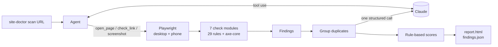

# 🩺 Site Doctor

**An AI agent that explores a website like a QA engineer, finds what's broken, and writes a scored report.**

[](https://github.com/panmm942-ui/site-doctor/actions/workflows/ci.yml)


Point it at a URL. Claude decides which pages are worth visiting, a real Chromium browser loads
each one, and 29 deterministic rules plus the full axe-core accessibility suite run on every
page: broken links, JavaScript errors, accessibility, SEO, Core Web Vitals, security headers and
the phone layout. At the
end, Claude explains every issue in plain English and suggests a fix.


> The GIF, the report screenshot and [`examples/sample-report.html`](examples/sample-report.html)
> are generated by `site-doctor demo` (see [Recording the demo](#recording-the-demo)).

## How it works



Site Doctor splits the job between Claude and plain code:

- **Claude steers.** It reads each page's summary (issue counts, top issues, unvisited links) and
  decides where to go next, which links to check, and which pages to screenshot, within a page
  budget.
- **Code judges.** Every check is a pure function of what the browser captured, and severities and
  scores come from fixed rules. The same site always gets the same grade, and the checks are unit
  tested without an API key.
- **Claude explains.** Duplicate findings are merged ("missing CSP on 15 pages" becomes one issue),
  then one structured-output call returns an explanation and a fix for each issue.

Limits (page budget, step cap, timeouts, staying on one site) are enforced in code, not left to
the prompt. If the API fails or you press Ctrl+C, you still get a partial report.

## Quickstart

```bash
git clone https://github.com/panmm942-ui/site-doctor && cd site-doctor
python -m venv .venv && source .venv/bin/activate      # Windows: .venv\Scripts\activate
pip install -e .
playwright install chromium
export ANTHROPIC_API_KEY=sk-ant-...                    # Windows: $env:ANTHROPIC_API_KEY="sk-ant-..."

site-doctor demo                     # scan the bundled demo shop (planted bugs, runs locally)
site-doctor scan https://example.com
```

Reports land in `reports/<host>-<time>/` as `report.html`, `findings.json` and `screenshots/`.

## Usage

| Command | What it does |
|---|---|
| `site-doctor scan URL` | Examine a website and write a report |
| `site-doctor demo` | Serve the bundled demo shop on localhost and examine it |
| `site-doctor render findings.json` | Rebuild `report.html` from an earlier scan, without calling the API |

| Option | Default | |
|---|---|---|
| `--max-pages` | `15` | Most pages to open (link checks don't count) |
| `--effort` | `medium` | How hard Claude thinks: `low`, `medium`, `high`, `xhigh`, `max` |
| `--model` | `claude-opus-5-5` | Any Claude model, e.g. `claude-sonnet-5-5` for cheaper runs |
| `--no-mobile` | off | Skip the phone-size pass and phone screenshots |
| `--out` | `reports` | Where reports are written |
| `--plain` | off | Plain line output instead of the live view (automatic when piped) |
| `--open` | off (`demo`: on) | Open the report in your browser when done |

## What it checks

| Category | Rules (severity) |
|---|---|
| Basics | page 5xx (critical), page 4xx (high), page fails to load (critical on the start URL, else high), uncaught JS error (high), console errors (medium), missing title (medium) |
| Links | broken internal link (high), broken external link (medium), unreachable host (medium) |
| Accessibility | every [axe-core](https://github.com/dequelabs/axe-core) violation: critical → critical, serious → high, moderate → medium, minor → low |
| SEO | missing meta description (medium), not exactly one h1 (low), no canonical (low), missing Open Graph tags (low), no robots.txt / sitemap.xml (low) |
| Performance | LCP > 4s (high) / > 2.5s (medium), CLS > 0.25 (high) / > 0.1 (medium), TTFB > 800ms (medium), page > 3 MB (medium), image > 500 KB or over 2× its displayed size (low) |
| Security | no HTTPS (critical; localhost exempt), mixed content (high), no HSTS (medium), no CSP (medium), no `nosniff` (low), no frame protection (low) |
| Mobile | no viewport tag (high), page scrolls sideways (high), tap targets under 24×24px (medium) |

## Scoring

Each of the seven categories starts at 100. Every issue subtracts a penalty by severity:
**critical 25, high 10, medium 4, low 1**. An issue on several pages costs more: the penalty is
multiplied by `1 + 0.1 × (pages − 1)`, capped at 2×. Scores never go below 0.

The overall score is the average of the seven categories. Grades: **A** ≥ 90, **B** ≥ 80,
**C** ≥ 70, **D** ≥ 60, otherwise **F**.

## Cost

Each scan makes one Claude request per crawl step plus one for the explanations. The report's
"Run details" section shows the exact tokens used and an estimated cost. For cheaper runs, use
`--model claude-sonnet-5-5`, `--effort low` or a smaller `--max-pages`.

## Development

```bash
pip install -e ".[dev]"
playwright install chromium
pytest          # ~100 tests, no API key or internet needed
ruff check src tests
```

The tests serve the bundled demo site on localhost and check that each planted bug is found, and
that a clean page comes back clean. The agent is tested with a scripted fake Claude client that
covers page budgets, redirects, failed pages, API errors and Ctrl+C.

```
src/site_doctor/
├── agent.py         Claude tool-use loop + the explanation call
├── browser.py       Playwright capture: page, network, timings, axe, phone view
├── checks/          one module per category, each a pure function
├── triage.py        merges duplicate findings
├── scoring.py       rule-based scores and grade
├── report.py        HTML (Jinja2) + JSON output
├── ui.py            Rich live view / plain output
├── cli.py           Typer commands
└── demo_site/       the demo shop, with planted bugs
```

### Recording the demo

```bash
site-doctor demo --no-open                      # writes reports/127.0.0.1-…/report.html
cp reports/127.0.0.1-*/report.html examples/sample-report.html   # copy screenshots/ too
vhs demo.tape                                   # records docs/demo.gif (https://github.com/charmbracelet/vhs)
```

Then take a screenshot of the report for `docs/report.png`.

## License

MIT. axe-core is bundled under the Mozilla Public License 2.0
(see `src/site_doctor/checks/vendor/axe-core-LICENSE.txt`).
